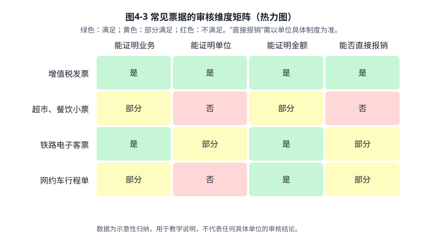
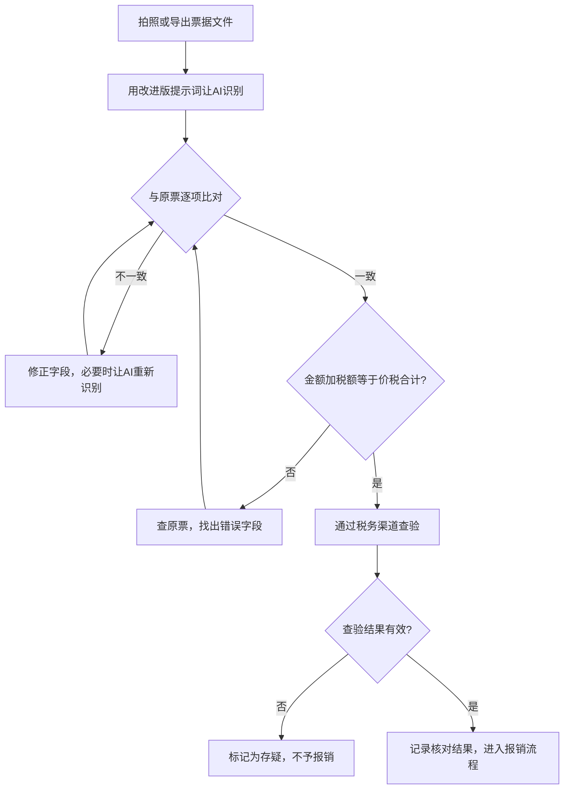
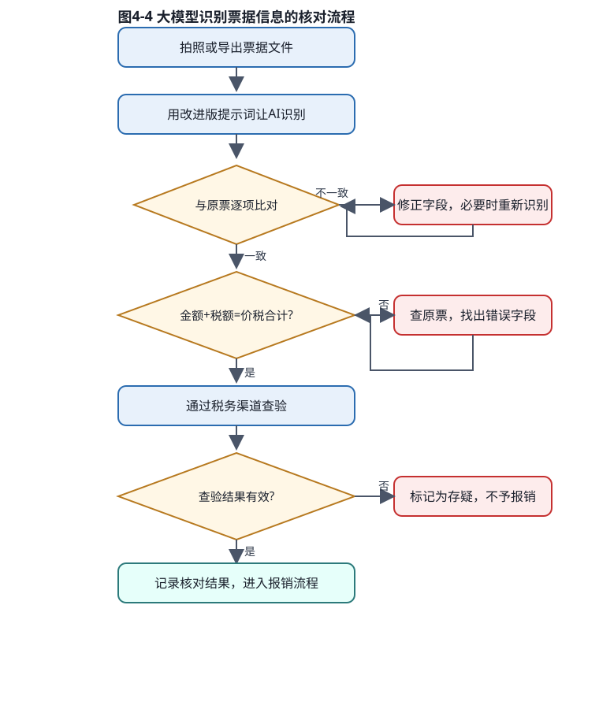

# 项目4 从一张报销单说起：票据与报销

> 版本：v2（2026年10月27日）｜ 状态：待审阅 ｜ 上一版：v1（已被本版替换，不再保留）

## 项目导入

**校园线**

校园文化节前一周，某高校学生社团“星空读书会”忙得不可开交。社长小林把一周的票据整理成一叠，准备到学院财务处报销：打印店的海报费收据、文具店的彩带小票、超市买来的矿泉水和零食小票，还有一张打印店开具的增值税发票。

财务老师看了一眼，只收下了其中一张，并且说：“超市小票没有学院的抬头，不能报；收据要换成发票，发票的抬头要写学院的全称和税号。”小林有点懵：这些钱都是社团花的，为什么有的能报，有的不能报？

*图4-1 报销场景（AI文生图）*

**职业线**

实习生小周在一家文创用品公司的财务部实习。上周，市场部的两位同事去外地参加展会，回来交来一叠报销材料：高铁票、网约车行程单、酒店发票、几张餐饮小票。部门经理让小周先整理，看哪些能报销、哪些需要补充。小周翻了半天，只能确定其中一部分，心里没底：是不是只要有票据就能报？

两个问题其实是同一个问题：**报销单只是申请，票据才是证据。** 要判断一笔钱能不能报，先要看懂票据，知道票据上哪些信息证明了这笔钱的用途和去向。这正是本项目要解决的问题。

## 学习目标

- **知识目标**：知道常见票据的种类；能说出发票上的关键信息；理解报销对票据的基本要求及其法律依据。
- **技能目标**：能用大模型辅助识别票据信息；能按照核对表与原票逐项比对；能对识别错误进行修正和记录。
- **素养目标**：养成“先核对、后报销”的习惯；理解报销是对公款的管理，不轻信 AI 的识别结果，也不轻信自己的记忆。

## 任务4.1 看懂票据和发票的关键信息

*图4-2 票据整理场景（AI文生图）*

### 一、为什么报销要看票据

**（一）原始凭证是什么**

在会计工作中，业务发生时取得或填制的、用来证明经济业务真实发生的书面或电子证据，称为**原始凭证**。报销单、记账凭证都是在它的基础上形成的。

《中华人民共和国会计法》（2024年修正）第十四条规定：办理经济业务事项，必须填制或者取得原始凭证并及时送交会计机构；会计机构、会计人员对不真实、不合法的原始凭证有权不予接受，对记载不准确、不完整的原始凭证予以退回，并要求更正、补充。

这条规定说明了两件事：一是报销必须有原始凭证作依据；二是原始凭证不仅要有，还要真实、合法、完整。

**（二）原始凭证应当具备哪些内容**

财政部《会计基础工作规范》（财政部令第98号，2019年修订）第四十八条规定，原始凭证的内容必须具备：凭证的名称；填制凭证的日期；填制凭证单位名称或者填制人姓名；经办人员的签名或者盖章；接受凭证单位名称；经济业务内容；数量、单价和金额。

这七项内容可以理解为票据的“体检标准”。以后遇到任何票据，都可以先问一句：这七项有没有？

> 说明：财政部部分规章可能有修订或征求意见稿，本书以现行有效文本为准，出版前及使用时需查询最新规定。

**（三）为什么超市小票常常不能报**

超市小票上通常有商品名称、金额和时间，看起来很完整。但它缺少两个关键要素：一是**接受凭证单位名称**，即无法证明这笔钱是由哪个单位支付的；二是**经办人或审批人**的信息，无法证明这笔支出经过了内部审批。

《发票管理办法》（2023年修订，国务院令第764号）第二十条规定：不符合规定的发票，不得作为财务报销凭证，任何单位和个人有权拒收。因此，小票不能代替发票作为报销凭证，这一要求有法律依据。

这里要注意：**“不能报”不等于“不能花”**。社团的采购支出如果没有合规票据，仍然要记入社团的收支记录，只是不能作为报销依据。这一点在项目2的收支记录中会再次用到。

### 二、常见票据有哪些

校园和职场中，最常见的几类票据如表4-1所示。

**表4-1 常见票据类型及报销要点**

| 票据类型 | 常见来源 | 报销时需要关注的要点 |
|---|---|---|
| 增值税发票（普通发票、专用发票、电子发票） | 打印店、文具店、酒店、餐饮店、电商平台 | 购买方名称和税号是否为单位信息；金额、税额、价税合计是否完整；是否可通过税务机关提供的渠道查验 |
| 财政票据、非税收据 | 学校收取的各类费用，如学费、住宿费 | 按收费性质开具，通常不作为采购支出的报销凭证，具体以学校制度为准 |
| 铁路电子客票 | 火车出行 | 属于电子发票，不再使用纸质报销凭证；报销时以电子发票为凭证，具体以单位制度为准 |
| 机票电子行程单、网约车行程单 | 航空出行、网约车出行 | 通常与发票配合使用；是否需要配合使用、需要哪些信息，以单位制度为准 |
| 超市、餐饮小票 | 日常购物、用餐 | 多数单位制度不予报销，因为不具备接受单位信息，且不属于发票 |

图4-3 从三个审核维度对几类常见票据作了归纳，便于快速判断。

*图4-3 常见票据的审核维度矩阵（SVG热力图，示意归纳）*

**关于铁路票据的说明**：2024年，国家税务总局、财政部、中国国家铁路集团有限公司发布公告（2024年第8号），规定铁路客运推广使用全面数字化的电子发票。公告规定，2025年10月1日起铁路客运全面使用电子发票，乘车日期在2025年9月30日前的纸质车票仍可报销。如果你的单位还要求提供行程信息，应当按单位制度执行，不要想当然地认为“只要有票就行”，也不要认为“必须补一张行程单”。

**关于增值税抵扣的说明**：在企业财务中，增值税专用发票和普通发票的用途不同，能否抵扣进项税额，取决于发票类型、纳税人身份以及具体业务。根据国家税务总局公告2019年第45号，2017年1月1日及以后开具的增值税专用发票等扣税凭证，取消了认证确认、稽核比对和申报抵扣的期限，但具体抵扣规则仍需按照现行税收规定执行。学生在这里只需要理解一点：**不同发票的用途不同，报销时要按单位的要求取得正确的票据。**

### 三、发票上的关键信息

发票是报销中最常见的票据。为了便于检查，可以把发票的关键信息整理为一张核对表，如表4-2所示。

**表4-2 发票关键信息核对表**

| 序号 | 检查项目 | 检查要点 | 常见问题 | 为什么重要 |
|---|---|---|---|---|
| 1 | 发票类型 | 普通、专用、电子发票，类型与业务要求一致 | 把收据、小票当成发票 | 决定能否作为报销凭证 |
| 2 | 发票代码与号码 | 完整清晰，可通过税务机关渠道查验 | 照片模糊、号码看不清 | 关系到发票是否真实 |
| 3 | 开票日期 | 与业务发生时间基本一致 | 跨期、超出单位规定的报销期限 | 关系到费用归属期间 |
| 4 | 购买方名称 | 为单位全称，与单位章一致 | 写成个人姓名或简称 | 证明费用由哪个单位承担 |
| 5 | 购买方税号 | 为单位的统一社会信用代码或纳税人识别号 | 漏填、填错、借用他人税号 | 与购买方名称共同证明单位身份 |
| 6 | 销售方名称 | 与实际交易的商家一致 | 与收款人或付款对象不一致 | 证明款项付给了谁 |
| 7 | 项目名称 | 与实际用途对应 | 只写“办公用品”“服务费”等笼统名称 | 证明款项买的是什么 |
| 8 | 金额、税率、税额、价税合计 | 不含税金额加税额等于价税合计 | 数字错误、漏填、大小写不一致 | 关系到金额是否准确 |
| 9 | 是否重复报销 | 同一张发票只能报销一次 | 同一张发票在不同时间重复提交 | 防止虚报重复 |

**一个简单的验证方法**（可用图4-5的核验工具练习，见下方链接）：假设价税合计为 255.85 元，税率为 13%，则不含税金额应为 255.85 ÷ 1.13 ≈ 226.42 元，税额为 226.42 × 13% ≈ 29.43 元。两者相加仍为 255.85 元，说明这组数字内部自洽。如果数字对不上，就要进一步查原票。

**需要特别注意的是**：如果发票的购买方、销售方、项目名称或金额与实际经营业务不一致，就属于《发票管理办法实施细则》第二十九条所说的“与实际经营业务情况不符”，情节严重的可能构成虚开发票。因此，核对发票不是形式上的“看一眼”，而是要确认票据内容与实际业务是否一致。

### 四、实践：用大模型识别发票信息并核对

本节的操作可以用任何一款大模型工具完成。工具的界面和功能会不断变化，操作以原理和步骤为主。

**（一）准备票据文件**

1. **优先使用原始电子文件**。如果是电子发票，优先下载 PDF 或 OFD 格式文件，不要用截图。电子文件的信息比拍照更清楚，识别错误更少。
2. **纸质票据要拍清楚**。平放在桌面上，光线充足，不要有反光和阴影，四角完整入镜。如果发票上有折痕，尽量展平后再拍。
3. **只上传需要报销的票据**。不要把身份证、银行卡、手机号等与报销无关的信息一起上传。如果票据上有个人信息，可以遮挡无关部分。

**（二）输入提示词**

提示词的质量直接影响识别效果。下面给出两个版本，便于对比。

**基础版提示词**：

> 请识别这张发票的信息。

这样的提示词太笼统，大模型可能只给出一段概括，或者遗漏关键字段。

**改进版提示词**：

> 你是一名财务助理。请识别我上传的发票，并按以下字段输出为表格：发票类型、发票代码、发票号码、开票日期、购买方名称、购买方税号、销售方名称、项目名称、金额、税率、税额、价税合计。
> 要求：
> 1. 严格按照发票上的文字填写，不要改写、不要补充；
> 2. 如果某个字段看不清或无法识别，请填写“无法识别”，不要猜测；
> 3. 完成后，请检查“金额 + 税额 = 价税合计”是否成立，并在表格下方说明结果。

改进版提示词的关键有三点：**限定角色**，让大模型按财务的口径工作；**限定字段**，避免遗漏；**限定规则**，要求它承认不确定，而不是猜测。

**（三）检查输出结果**

大模型的输出需要经过三次核对。

第一次核对：**与原票逐项比对**。以原票为准，逐个字段检查。

第二次核对：**用计算检查数字**。检查金额、税率、税额和价税合计之间的关系。

第三次核对：**用税务机关提供的渠道查验**。对于纸质发票，可以通过税务机关提供的发票查验渠道，输入发票代码、号码、开票日期和金额，查看发票状态。对于电子发票，也可以通过对应渠道查验真伪。

假设大模型给出的识别结果如表4-3所示，我们用上面的方法逐项检查。

**表4-3 大模型识别结果及核对记录（示例）**

| 字段 | 大模型识别结果 | 原票 | 核对结论 | 处理方法 |
|---|---|---|---|---|
| 发票类型 | 增值税普通发票 | 增值税普通发票 | 一致 | 无需处理 |
| 开票日期 | 2026年10月18日 | 2026年10月18日 | 一致 | 无需处理 |
| 购买方名称 | 某学院星空读书会 | 某学院星空读书会 | 一致 | 确认是否为学院全称 |
| 购买方税号 | 91130000XXXXXXXXXX（示例） | 91130000XXXXXXXXXX | 一致 | 无需处理 |
| 项目名称 | 打印服务 | 打印服务 | 一致 | 确认是否与海报用途对应 |
| 金额 | 226.42 | 226.42 | 一致 | 无需处理 |
| 税率 | 13% | 3% | 不一致 | 修正为原票数值，并重新计算税额 |
| 税额 | 29.43 | 6.79 | 不一致 | 按修正后的税率重新计算 |
| 价税合计 | 255.85 | 233.21 | 不一致 | 按修正后的金额重新计算 |

这个例子说明：大模型的识别整体准确，但在税率这类数字字段上可能出错，而且错误会连带影响税额和价税合计。因此，**大模型给出的计算结果不能直接采信，必须用原票和计算两重核对。** 本例中，原票税率是3%，大模型误识别为13%；按照3%重新计算，不含税金额226.42元，税额约为6.79元，价税合计约为233.21元。

> 注：表中税号为示例号码，不是真实税号。

**（四）记录核对结果**

核对完成后，把结果录入表格，并在备注栏注明处理状态：**已核对、需更正、需补充、不可报销**。这样做的好处是，即使以后有人询问，也能说清楚每一张票据是怎么处理的。

图4-4 展示了上述核对流程，可以作为操作时的参考。

图4-4 同时以 mermaid 源文件（`图表/项目4_图4-4_核对流程_v1.mmd`）和 SVG 图（`图表/项目4_图4-4_核对流程_v1.svg`）保存。下方为 mermaid 代码：

*图4-4 大模型识别票据信息的核对流程*

交互练习：打开 [图4-5 发票金额核验工具](图表/项目4_图4-5_发票金额核验_v1.html)（HTML，可在浏览器中直接打开），输入表4-3中的数字进行核验。

### 五、常见错误与应对

下面是使用大模型识别票据时常见的错误，以及相应的应对办法。

**表4-4 大模型识别票据的常见错误**

| 错误类型 | 典型表现 | 应对办法 |
|---|---|---|
| 数字错认 | 把 3 认成 8，把 1 认成 7 | 与原票逐个数字核对，重点核对税号和金额 |
| 字段遗漏 | 漏掉购买方税号或开票日期 | 用字段清单逐项检查，缺项时要求补充 |
| 连带错误 | 税率错了，税额和价税合计也跟着错 | 先修正源头字段，再重新计算 |
| 过度推断 | 对模糊字样“猜”出一个名称 | 要求标注“无法识别”，不接受猜测结果 |
| 把模板当结果 | 输出的是格式示例，而不是图片内容 | 确认大模型确实读取了图片，可以要求它说明识别的依据 |

这些错误说明：**大模型是助手，不是判断者。** 最终判断应当由人作出，这一点在后续项目中会反复强调。

### 六、拓展（选做）

**拓展一：为什么报销要强调“同一张发票只能报销一次”**

如果同一张发票被多次报销，就会造成单位支出虚增，也会造成账实不符。很多单位会在报销系统中设置发票查重功能，或要求报销人在票据上签注“已报销”。从内部控制的角度看，这是为了防止重复支付。学生可以思考：如果没有这些措施，单位的财务风险会在哪里？

**拓展二：用表格汇总一批票据的金额**

把表4-3的核对结果放入 Excel，用求和公式计算报销合计，并与报销单的合计数进行比对。这一操作会在项目8中展开，这里可以先尝试：在表格中输入“=SUM(...)”即可完成求和。

### 七、回到案例

**回到校园线**

小林把社团的票据按照表4-1和表4-2重新检查，分成四类，并写明理由：

| 类别 | 票据 | 理由 | 处理办法 |
|---|---|---|---|
| 可以报销 | 打印店增值税发票（已更正为学院抬头） | 发票类型、抬头和税号符合要求 | 附入报销单 |
| 需要补充 | 彩带收据 | 收据不是发票，不能作为采购报销依据 | 向文具店索取增值税发票，抬头写学院全称 |
| 需要确认 | 矿泉水、零食的购物凭证 | 是否属于活动支出，以学院规定为准 | 向财务老师咨询后再决定 |
| 不能报销 | 超市小票 | 无抬头、无税号，不能证明单位用途 | 作为社团支出记录保留，不作为报销凭证 |

小林明白了：不是“花了钱就能报”，而是“票据能证明这笔钱的用途和归属，才能报”。她还意识到，为了让财务老师顺利审核，以后采购时应当先问清楚对方能否开具学院抬头的发票。

**回到职业线**

小周用同样的方法整理了公司的差旅票据，并按照“能否证明业务、能否证明单位、能否证明金额”三个问题进行分类：

| 类别 | 票据 | 理由 | 处理办法 |
|---|---|---|---|
| 可以报销 | 酒店增值税发票（抬头为公司全称，税号正确） | 能证明单位、业务和金额 | 附入报销单，核对住宿日期与出差日期 |
| 可以报销 | 网约车发票及行程单 | 能证明出行时间、路线和金额 | 核对行程日期与出差日期是否一致 |
| 按制度处理 | 高铁电子客票 | 属于电子发票，报销以电子发票为凭证 | 按公司制度核对是否还需提供其他材料 |
| 不能报销 | 餐饮小票 | 不属于发票，无抬头、无税号 | 按公司制度不予报销，并告知报销人 |

小周把分类结果交给部门经理。经理看后说：“以后你先用这张核对表过一遍，再拿给我看。另外，去年的差旅制度你要先读一遍，很多问题在制度里都有答案。”

这句话也正是本书要强调的：**大模型可以帮你整理票据，但单位制度和法律规定才是判断的依据。**

---

**下一步**：任务4.2 用检查清单审核报销材料（待写）。

## 法律与制度依据（本任务引用）

1. 《中华人民共和国会计法》（2024年修正），第十四条。
2. 《会计基础工作规范》（财政部令第98号，2019年修订），第四十八条。
3. 《中华人民共和国发票管理办法》（2023年修订，国务院令第764号），第二十条。
4. 《中华人民共和国发票管理办法实施细则》（国家税务总局令第56号），第二十九条。
5. 国家税务总局公告2019年第45号，关于取消增值税扣税凭证认证确认期限等事项。
6. 国家税务总局、财政部、中国国家铁路集团有限公司公告2024年第8号，关于铁路客运推广使用全面数字化的电子发票。

> 说明：法律和制度会修订。出版前需逐条核对现行有效文本，并以单位制度为准。
